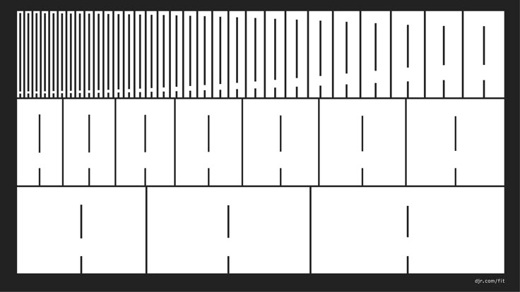
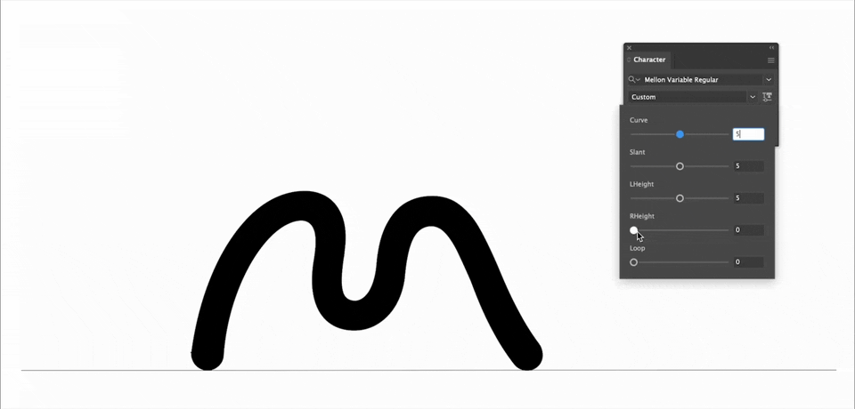
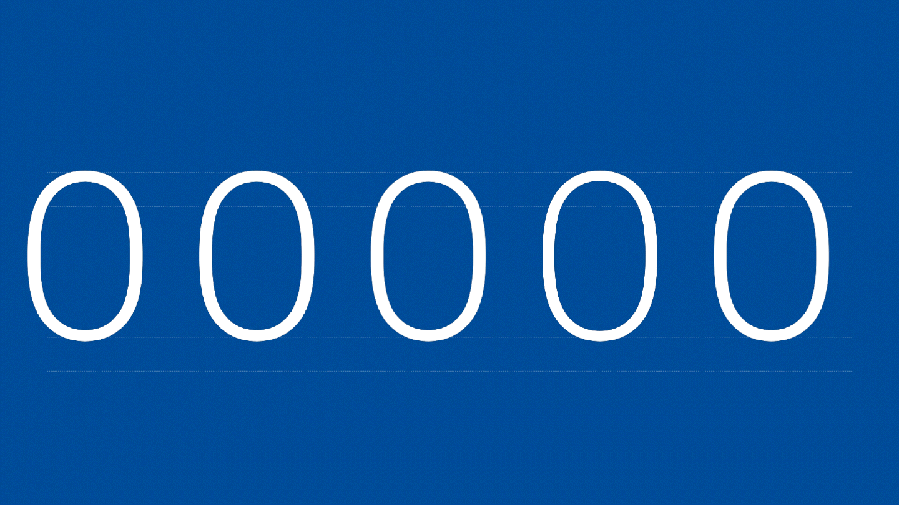
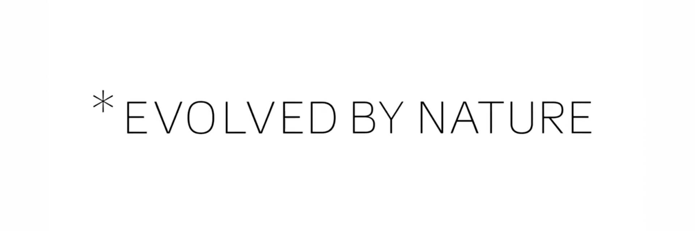
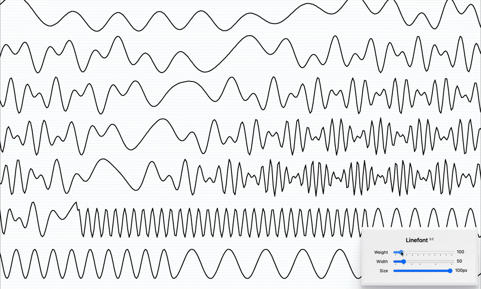
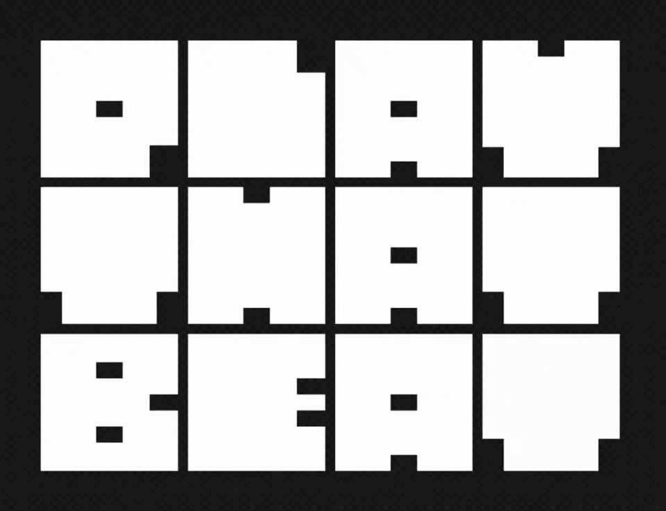
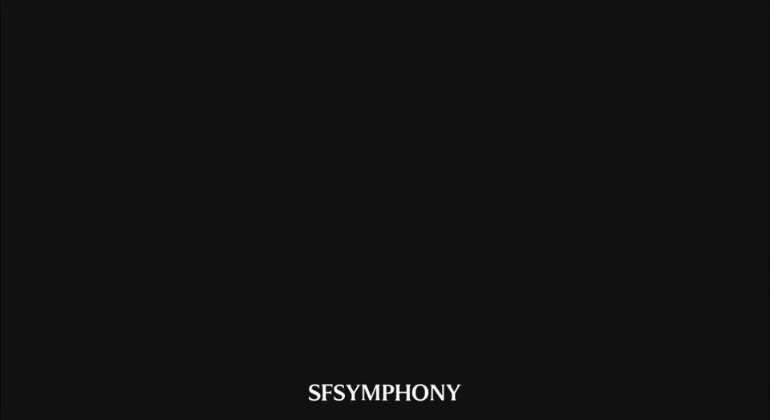

# 🔬 p4 ~ specimen

[primary rotate]

[slide]

::: bg primary

## 📖 introduction

:::

[slide]

### 🔤 what’s a type specimen?

when a type foundry releases a font, they usually release a **specimen** to showcase the font. this is a *visual thing* ~ website, publication, video, etc. ~ that showcases the font’s design and functionality.

let’s take a look at a couple of examples of real-world digital type specimens:

1. [**gt maru**](https://www.gt-maru.com/) ~ a website full of life.
2. [**commit mono**](https://commitmono.com/) ~ a website minimicking a computer terminal.
3. [**ozik soft**](https://nuformtype.com/ozik-soft) ~ a website that’s basically just a poster (but a really cool poster).
4. [**trekker**](https://trekker.occupantfonts.com/) ~ a website providing an experimental experience evoking the font’s forms.
5. [**redaction**](https://www.redaction.us/) ~ website evoking the font’s themes.

[slide]

### ❓ why make a specimen?

there are two primary reasons for creating a type specimen:

1. **r&d ~ ** as a proof-of-concept for your font’s usefulness and potential applications. *think of this like what we’ve done in the course so far: make websites to test our fonts.*
2. **marketing ~ ** to advertise your font so that other people actually want to use it. *for example, if you want to sell your font.*

[slide]

### 🤝 specimens + us

in this course so far, you’ve created websites that showcase custom fonts. technically speaking, you’ve already created 3 type specimens:

| ✏️ project | 🔤 font | 🌐 specimen |
| --- 1 | --- 2 | --- 2 |
| **🧶 p1** | pixel font | ASCII art website |
| **🎭 p2** | variable component font | web-based performance |
| **🗣️ p3** | variable open-source remixed font | digitally typeset article |

[slide]

i provided you processes for each of these projects as a way to get you to think about what a font is capable of:

| ✏️ project | 🧪 process | 🧠 meaning |
| --- 1 | --- 2 | --- 2 |
| **🧶 p1** | type + code = textile | fonts are a unique material capable of **drawing forms and weaving patterns** |
| **🎭 p2** | type + code = performance | fonts can come to life and enact **time-based or interactive experiences** |
| **🗣️ p3** | type + code = dialectic | fonts can add **nuance and meaning** when used in articles or other forms of writing |

[slide]

for your final project, i am asking you to come up with, propose, and demonstrate a new process. or, in other words:

::: big

type + code = ...something?

:::

let’s take a look at some fonts that have prototyped unique processes combining type and code (a few of which you’ve seen before):

[slide]

#### 🧱 type + code = brick wall

what if a font could entirely fill up ALL the space provided? that’s what [fit by djr](https://djr.com/fit) does. its variable axis is a hybrid of a weight and width axis, allowing the font to resize precisely to fill whatever space it’s in.

[slide]

#### 📐 type + code = logo

for [the mellon foundation](https://www.pentagram.com/work/the-mellon-foundation), pentagram created a variable font containing just the letter M, which served as the organization’s logo. except, this M included 5 variable axes, enabling numerous variations on the logo’s design.

[slide]

#### 🔥 type + code = optimization

google developed a variable version of their font roboto called [roboto flex](https://fonts.google.com/specimen/Roboto+Flex). what makes this variable special are its 12 (yes, TWELVE) variable axes.

to achieve this, the font has 85 font masters, all packed within a pretty tiny 1.7MB font file. meanwhile, if we had to export this font as static font files (i.e. not a variable font), we would end up with 85 font files totaling 4.8MB.

so, we end up with three clear benefits:

1. the exported font file is much smaller.
2. we don’t have to individually add 85 font files to our website, and can add just the one variable font file.
3. we get an ENORMOUS design space to work within given all the possible variable permutations.

[slide]

#### 🌅 type + code = gradient

[*evolved by nature](https://www.behance.net/gallery/90124475/Evolved-By-Nature) creates a font weight gradient that moves away from / toward any asterisk. the logo uses this directly, but an asterisk can be played anywhere in text and the font will dynamically update to add the appropriate gradient.

[slide]

#### 📊 type + code = data viz

dmitry ivanov’s [linefont](https://fonts.google.com/specimen/Linefont?preview.script=Latn) appropriates font technology to make it exceedingly easy to draw or customize line graphs. see also: [wavefont](https://fonts.google.com/specimen/Wavefont?preview.script=Latn).

[slide]

#### 🥁 type + code = music viz

i created [music box](https://toomuchtype.com/fonts/music-box/) to respond to and visualize a beat. it’s as simple as that.

[slide]

i’m not the only one. for their [branding of sf symphony](https://wearecollins.com/case-studies/san-francisco-symphony), collins created a variable font also meant to evoke music.

[slide]

### 🛑 in summary...

by now, you should be getting the point. combining type and code introduces numerous possibilities for new forms, experiences, and meanings.

so, now it’s your turn!

[primary rotate]

[slide]

::: bg primary

## 🔍 project description

:::

[slide]

### ✏️ prompt

propose a new process for combining type and code using the format **type + code = _**

demonstrate this process by creating the following:

1. an **original font** (variable optional)
2. a **web-based type specimen** (using your original font)

there are no specific requirements for this project, as long as you create an original font and a website to showcase it.

[slide]

since this project is open-ended and self-directed, you will need to come up with a way to approach it. here are two options:

::: columns

#### 👆 **bottom-up**

this is what we’ve done so far this semester. learn a new skill or technology, and then explore all the possibilities that emerge from there.

+++

#### 👇 **top-down**

this is the opposite approach. start from an idea, and then figure out what you need to do to achieve that idea.

:::

[ignore]

---

[slide]

### 📋 progress reports

each week leading up to the final crit, you will give a **progress report** showing updates on both your font and your website.

each week’s presentation should be created as a new **are.na channel**. details:

1. create an are.na channel called `type+code f26 / week #` (use the number of the week you’re presenting during).
2. start with a **text block** overview of your progress.
3. add at least **3 sources of inspiration** you were looking at that week. at least one should be a font-related project, and at least one should be a web-related project.
4. take **10–20 screenshots or recordings** of your type design / web programming work. put them in the order you want to present them during class.
5. if you have them, add **live links** to working prototypes.
6. add your are.na channel to the class channel TODO
7. use are.na’s **presentation mode** for sharing your channel in-class.

this presentation should be **~5min**. we’ll take another ~5min during class to give you feedback (for a total of ~1.5hr of sharing in class).

let’s take a look at an example are.na channel for this project:

EXAMPLE OF AN ARE.NA CHANNEL WITH SCREENSHOTS

[ignore]

---

[slide]

### 🤖 ai is allowed (if you want to use it)

ai is becoming an industry-standard tool for web development. you may have conflicted feelings about its use, whether it relates to environmental, plagiarism, or other concerns. those are valid concerns. BUT, i still need to make sure you’re prepared to work in the real world, and not using ai puts you at a major disadvantage.

in this project, i’ll demonstrate several ways of working with ai that achieve the following:
- high quality outputs
- designs that speak to your unique creative voice
- learning new skills while you’re prompting ai

that being said, **AI IS OPTIONAL!**

if you do use ai, you must **acknowledge** that you’re using it and **explain** how you’re using it. additionally, the expectations for your work will be higher if you’re using ai.

if you do NOT use ai, no such disclaimers are required.

[ignore]

---

[slide]

### 🌐 javascript bootcamp

each week, i’ll also be giving you **weekly javascript tutorials**. i’ll use these tutorials to introduce new technologies and tools that you may want to incorporate into your final projects.

after each tutorial, you’ll be asked to **complete an exercise** demonstrating your understanding of the new topics. these exercises will count toward your final grade.

**note 1:** *javascript is NOT required for the final project!*

**note 2:** *ai is NOT allowed for the javascript exercises!*

[ignore]

---

[slide]

### 💯 grading

this project is worth **50% of your grade**, so it’s graded out of **50 possible points**. here’s how that breaks down:

| category | points | assessment |
| --- 2 | --- 1 | --- 4 |
| **javascript exercises** | 15 | completion of weekly in-class javascript exercises |
| **progress reports** | 25 | completion of weekly presentations |
| **final deliverable** | 15 | the final thing you come up with |

[ignore]

---

[slide]

### ⏳ timeline

every week from now on, our classes will look like the following:

1. 📋 progress reports
2. 🤖 some kind of ai exercise/discussion
3. 🌐 javascript tutorial + weekly exercise requirement

::: calendar

[9/1/26 off-white]

[10/1/26 off-white]

[11/3/26 primary]
**week 7**
- 👀 crit p1–3
- 🔬 kickoff p4

[11/10/26 primary]
**week 8**
- 📋 progress reports
- 🤖 ai exercise
- 🌐 javascript tutorial

[11/17/26 primary]
**week 9**
- 📋 progress reports
- 🤖 ai exercise
- 🌐 javascript tutorial

[11/24/26 primary]
**week 10**
- 📋 progress reports
- 🤖 ai exercise
- 🌐 javascript tutorial

[11/25/26 - 11/29/26 gray]
🦃 thanksgiving break, no classes

[12/1/26 primary]
**week 11**
- 📋 progress reports
- 🤖 ai exercise
- 🌐 javascript tutorial

[12/8/26 primary]
**week 12**
- 📋 progress reports
- 🤖 ai exercise
- 🌐 javascript tutorial

[12/10/26 gray]
📚 reading period, no classes

[12/11/26 gray]
📚 liberal arts exams, no classes

[12/15/26 primary]
**week 13**
- 🏆 final crit!
- ✅ course evals

[12/18/26 off-black]
revisions due

:::